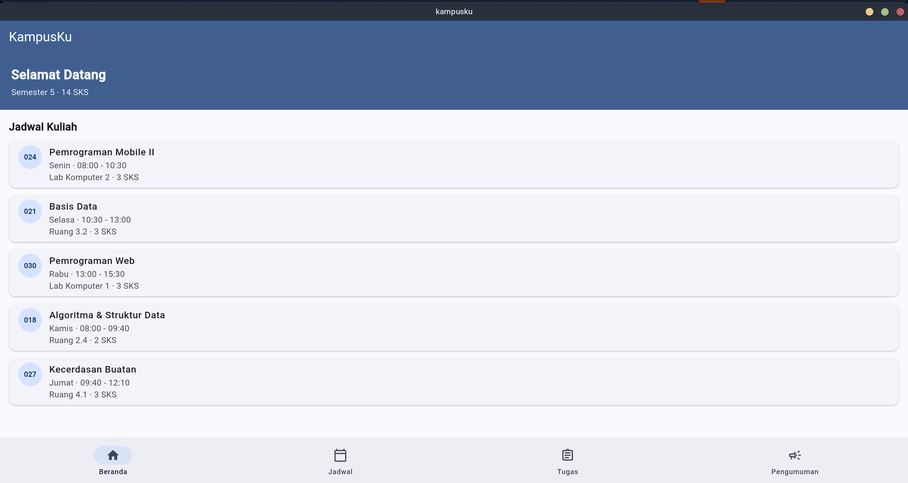
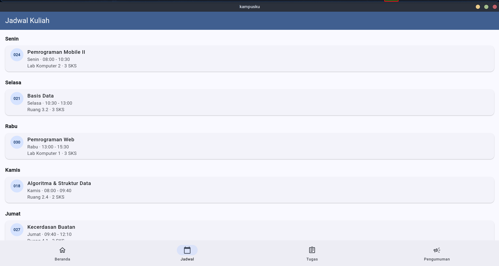
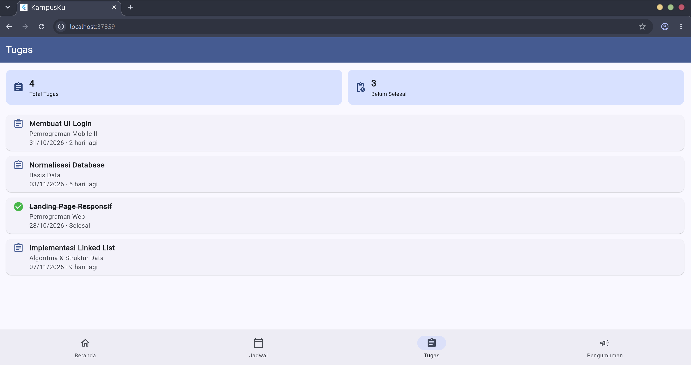
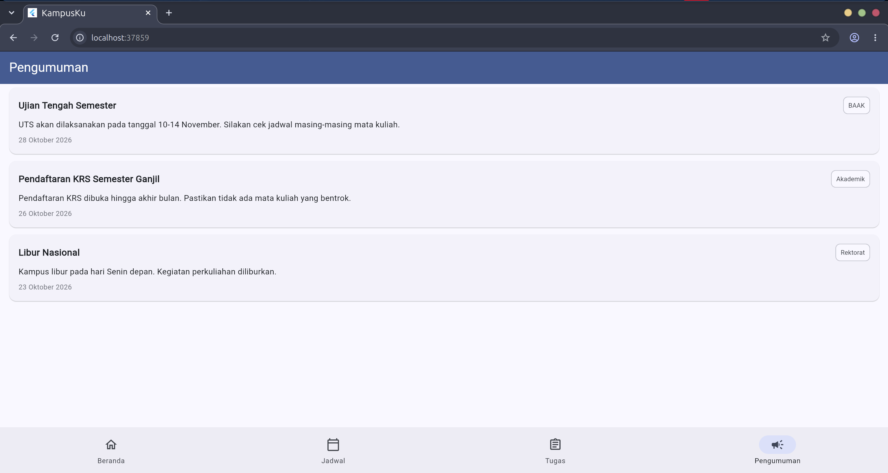

# KampusKu

Aplikasi mobile Flutter untuk mahasiswa — pusat informasi perkuliahan dalam satu app.
Menampilkan jadwal kuliah, daftar tugas beserta tenggat, dan pengumuman kampus.

## Fitur

- **Beranda** — ringkasan salam, total SKS semester, dan daftar jadwal kuliah.
- **Jadwal** — jadwal kuliah dikelompokkan per hari (Senin–Jumat), lengkap kode ruang, jam, dan SKS.
- **Tugas** — statistik total tugas & belum selesai, daftar tugas dengan mata kuliah, tenggat, dan status selesai/belum.
- **Pengumuman** — pengumuman kampus dengan label sumber (BAAK, Akademik, Rektorat) dan tanggal.

Navigasi pakai bottom navigation bar dengan 4 tab.

## Struktur Project

```
lib/
├── main.dart                  # entry point
├── app.dart                   # konfigurasi MaterialApp
├── models/                    # model data (MataKuliah, Tugas, Pengumuman)
├── screens/                   # halaman + shell bottom nav
├── services/data_service.dart # sumber data
├── widgets/                   # tile list yang dipakai ulang
└── utils/                     # konstanta + formatter
```

## Menjalankan

```bash
flutter pub get
flutter run
```

Pilih device: `flutter run -d linux`, `-d chrome`, atau device Android.

## Build

```bash
flutter build linux
flutter build apk
```

---

## ScreenShoot

| Beranda | Jadwal |
|---|---|
|  |  |

| Tugas | Pengumuman |
|---|---|
|  |  |
